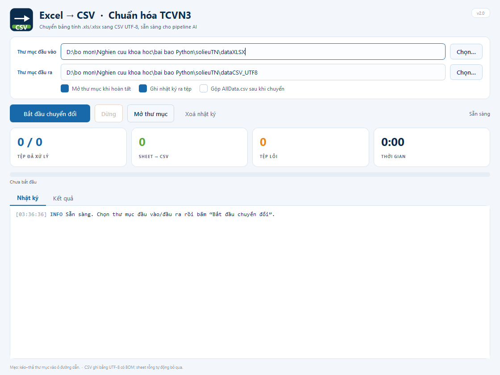

# SoilData2AI

**Chuẩn hóa dữ liệu chỉ tiêu cơ lý đất từ Excel/TCVN3 sang CSV UTF-8 để chuẩn bị dữ liệu huấn luyện AI.**

[]()
[]()
[]()

> Bài báo: *Sử dụng Python xử lý dữ liệu chỉ tiêu cơ lý đất để chuẩn bị dữ liệu huấn luyện AI* — ERSD 2026.
> Tác giả: Ngô Thị Phương Thảo, Ngô Hùng Long, Nguyễn Thị Hải Yến — Trường Đại học Mỏ – Địa chất.

---

## Vấn đề

Dữ liệu thí nghiệm đất thường nằm trong nhiều workbook `.xls/.xlsx`, mỗi hồ sơ có nhiều sheet, cấu trúc bảng không đồng nhất. Phần lớn văn bản được soạn bằng bảng mã **TCVN3** (font `.Vn…`), nên khi đọc/ghi trực tiếp sang UTF-8 sẽ bị sai dấu. Việc mở từng file, copy và sửa font thủ công tốn thời gian, dễ sai và khó tái lập.

**SoilData2AI** tự động hóa quy trình:

1. Quét hàng loạt `.xls/.xlsx` (kể cả tên dạng `.xls.xlsx`).
2. Đọc từng workbook, tách từng sheet có dữ liệu.
3. Nhận diện TCVN3 theo **font** và **mẫu ký tự**, chuyển sang Unicode.
4. Xuất **1 CSV UTF-8 (có BOM) cho mỗi sheet**, tên `ten_file_ten_sheet.csv`.
5. Ghi log OK/FAIL, bỏ sheet rỗng, giữ cấu trúc lưới để truy vết.
6. Tùy chọn gộp thành `AllData.csv` bằng `normalize.py`.

Kèm **GUI Qt6** và **EXE Windows** để dùng không cần cài Python.

---

## Kết quả trên bộ dữ liệu thử nghiệm

| Chỉ số | Bài báo (lần chạy trước) | Chạy lại bộ hiện hành |
|---|---:|---:|
| Tệp đầu vào | 166 (158 `.xlsx` + 8 `.xls`) | 166 |
| Tệp xử lý thành công | 166/166 | 166/166 |
| Sheet có dữ liệu → CSV | 963 | 962 |
| Mẫu trong `AllData.csv` | 20.532 | 20.352 |
| Tệp lỗi | 0 | 0 |

> Số liệu trong bài báo là của **lần chạy trước**. Khi chạy lại trên snapshot dữ liệu hiện hành, kết quả là **962 CSV / 20.352 dòng**. Khi công bố cần ghi rõ **ngày chạy, phiên bản mã nguồn và hash dữ liệu**; xem `docs/KET-QUA-KIEM-CHUNG.md`.

---

## Cài đặt

```bash
git clone https://github.com/<your-username>/SoilData2AI.git
cd SoilData2AI
python -m pip install -r requirements.txt
```

Yêu cầu:

- Python 3.10+ (đã test trên 3.12)
- `openpyxl` cho `.xlsx`
- `xlrd==1.2.0` cho `.xls` (xlrd ≥ 2.0 đã bỏ hỗ trợ `.xls`)
- `PySide6` cho GUI
- `Pillow`, `pyinstaller` chỉ cần khi build EXE/icon

---

## Dùng nhanh

### CLI

```bash
python src/xlsx2csv.py --input "D:\dataXLSX" --output "D:\dataCSV_UTF8"
python src/normalize.py --input "D:\dataCSV_UTF8" --output "D:\dataCSV_UTF8\AllData.csv"
```

Mặc định (theo cấu trúc repo):

- `src/xlsx2csv.py`: `dataXLSX/` → `dataCSV/`
- `src/normalize.py`: `dataCSV_UTF8/` → `dataCSV_UTF8/AllData.csv`

### GUI

```bash
python src/gui.py
```

GUI hỗ trợ chọn/kéo–thả thư mục, chạy nền, thanh tiến trình, log màu, bảng kết quả từng tệp, ghi log và tùy chọn gộp `AllData.csv`.



### Kiểm thử

```bash
python -m unittest discover -s tests -v
```

---

## Cấu trúc repo

```text
SoilData2AI/
├─ src/
│  ├─ xlsx2csv.py          # lõi Excel → CSV + TCVN3 → Unicode
│  ├─ normalize.py         # gộp CSV ngang → AllData.csv
│  └─ gui.py               # GUI Qt6 (PySide6)
├─ tests/
│  ├─ test_core.py
│  └─ test_gui_worker.py
├─ examples/
│  ├─ sample.xlsx / .xls   # dữ liệu mẫu nhỏ, không chứa dữ liệu thật
│  ├─ expected/            # CSV kết quả mong đợi
│  └─ make_sample.py
├─ scripts/
│  ├─ make_icon.py
│  └─ build_exe.ps1
├─ presentation/           # slide ERSD 2026 + code dựng slide
├─ docs/
│  ├─ 20-cau-hoi-phan-bien-va-tra-loi.md
│  ├─ PHUONG-PHAP.md
│  ├─ TCVN3-UNICODE.md
│  ├─ KET-QUA-KIEM-CHUNG.md
│  └─ GITHUB.md
├─ assets/
├─ Xlsx2CSV_Converter.spec
├─ requirements.txt
├─ CITATION.cff
└─ LICENSE
```

---

## Thiết kế chính

### 1. Nhận diện TCVN3 “lai”

Một chuỗi được chuyển mã khi:

- Font của ô là `.Vn…` hoặc chứa `TCVN3`, **hoặc**
- Chuỗi có **marker mạnh** (`¸`, `©`, `§`, `¢`, `£`, `¤`, `¥`, `¦`, `¬`, `®`, …), **hoặc**
- Chuỗi có **≥ 2 marker yếu** (`Ì`, `Ð`, `Ý`, `Ó`, `Ê`, …).

Cách này tránh nhầm các chữ Unicode hợp lệ như `núi`, `báo cáo`, `µm` với TCVN3.

### 2. Thay thế hai pha

Bảng ánh xạ có cả ký tự đơn và cụm hai ký tự (ví dụ `¢` → `Â`, `¢Ê` → `Ấ`). Nếu thay trực tiếp, cụm dài có thể bị phá trước khi được ánh xạ. Thuật toán:

```text
Pha 1: mỗi chuỗi nguồn → placeholder ::i::
Pha 2: mỗi placeholder → ký tự Unicode đích
```

### 3. CSV UTF-8 có BOM

Ghi bằng `utf-8-sig` để Excel mở đúng tiếng Việt, đồng thời `pandas` đọc được. Mỗi sheet có dữ liệu → một CSV; sheet rỗng bị bỏ qua. Tên file `ten_file_ten_sheet.csv` giúp truy vết nguồn.

### 4. Giữ cấu trúc lưới

Bản CSV giữ hàng/cột gần với sheet gốc, **chưa phải schema huấn luyện chuẩn**. Bước gắn nhãn, chọn cột, xử lý đơn vị/outlier và chia train/validation là nghiên cứu tiếp theo.

---

## Đóng gói EXE

```powershell
cd SoilData2AI
& .\scripts\build_exe.ps1
```

- Mặc định **không chạy pip** (tránh treo mạng/PATH). Muốn cài phụ thuộc: `-InstallDeps`.
- Spec `Xlsx2CSV_Converter.spec` chỉ giữ PySide6 + openpyxl + xlrd + lõi xử lý; loại trừ `torch`, `pandas`, `scipy`, `cv2`, `numba`…
- Kết quả: `dist\Xlsx2CSV_Converter.exe` (~54 MB).
- Kiểm tra:

```powershell
.\dist\Xlsx2CSV_Converter.exe --selftest
.\dist\Xlsx2CSV_Converter.exe --smoke-gui
.\dist\Xlsx2CSV_Converter.exe --cli --input "D:\dataXLSX" --output "D:\dataCSV" --merge
```

---

## Slide báo cáo

- `presentation/ERSD2026_NgoThiPhuongThao_Python_DataAI.pptx` — 19 slide, có speaker notes.
- `presentation/ERSD2026_NgoThiPhuongThao_Python_DataAI.pdf` — bản preview.
- `presentation/build_presentation.py` — dựng lại slide từ template.

```bash
cd presentation
python extract_template_assets.py
python build_presentation.py
```

---

## Tài liệu thảo luận

- **20 câu hỏi phản biện và trả lời gợi ý:** [`docs/20-cau-hoi-phan-bien-va-tra-loi.md`](docs/20-cau-hoi-phan-bien-va-tra-loi.md)
- Phương pháp chi tiết: [`docs/PHUONG-PHAP.md`](docs/PHUONG-PHAP.md)
- TCVN3 → Unicode: [`docs/TCVN3-UNICODE.md`](docs/TCVN3-UNICODE.md)
- Kết quả kiểm chứng: [`docs/KET-QUA-KIEM-CHUNG.md`](docs/KET-QUA-KIEM-CHUNG.md)
- Gợi ý mô tả repo GitHub: [`docs/GITHUB.md`](docs/GITHUB.md)

---

## Giới hạn

- Chưa có schema cột thống nhất giữa các đơn vị soạn thảo.
- Chưa kiểm tra đơn vị, phát hiện ngoại lệ số, giá trị thiếu hoặc trùng lặp.
- Chưa huấn luyện mô hình AI trong phạm vi bài báo.
- Chưa hỗ trợ VNI/VIQR hoặc bảng mã khác ngoài TCVN3.
- File hỏng/mã hóa mật khẩu cần xử lý thủ công; tool chỉ ghi log FAIL.
- Dữ liệu thật không được đưa vào repo; `examples/` chỉ chứa dữ liệu tổng hợp.

---

## Trích dẫn

Nếu dùng mã nguồn này, vui lòng trích dẫn bài báo ERSD 2026 (xem `CITATION.cff`).

```bibtex
@inproceedings{ngothiphuongthao2026soildata2ai,
  title     = {Sử dụng Python xử lý dữ liệu chỉ tiêu cơ lý đất để chuẩn bị dữ liệu huấn luyện AI},
  author    = {Ngô Thị Phương Thảo and Ngô Hùng Long and Nguyễn Thị Hải Yến},
  booktitle = {Hội nghị khoa học ERSD 2026},
  year      = {2026}
}
```

---

## Giấy phép

MIT — xem [`LICENSE`](LICENSE).

## English summary

SoilData2AI is a Python/Qt6 pipeline that batch-converts geotechnical soil-property spreadsheets (`.xls`, `.xlsx`) into UTF-8 CSV files for AI training. It detects legacy Vietnamese TCVN3 text via font metadata and character markers, converts it to Unicode with a two-phase replacement algorithm, skips empty worksheets, and preserves grid structure for traceability. The repository includes a CLI, a Qt6 desktop GUI, a PyInstaller build, tests, a 19-slide conference deck, and a 20-question rebuttal guide.
